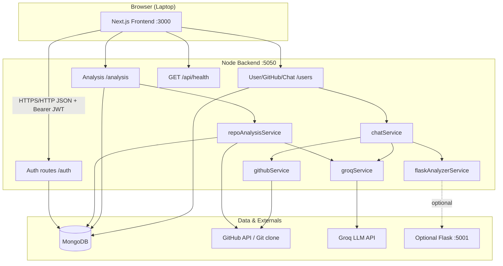
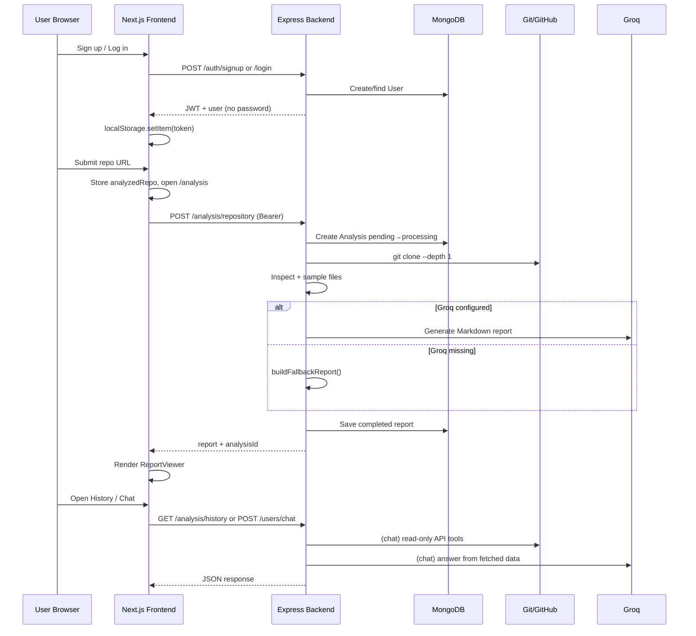
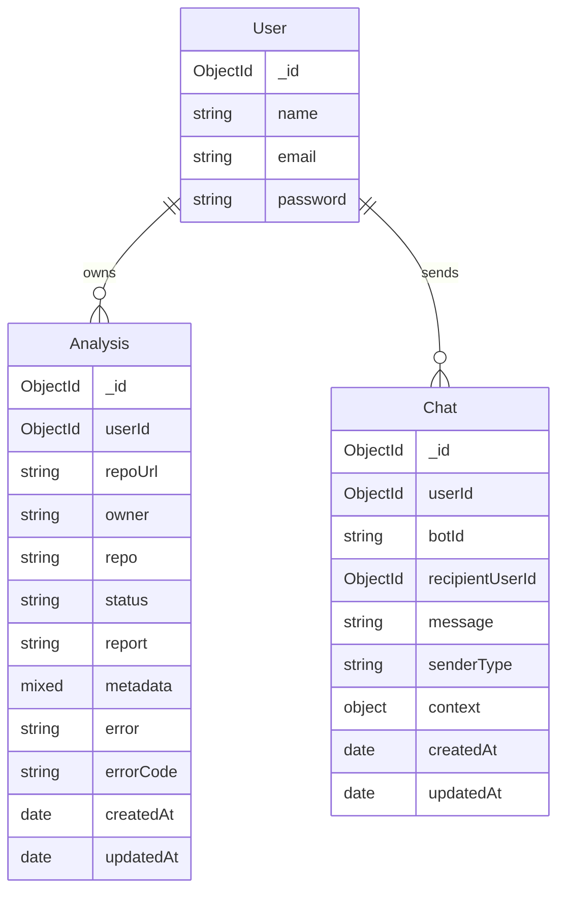
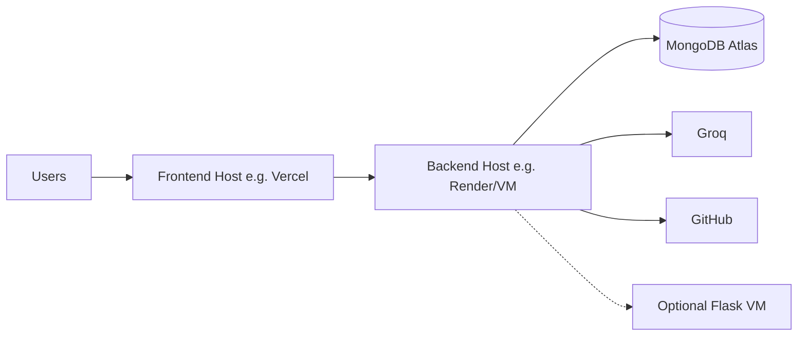

# RepoRadar — Technical Documentation & Project Handbook

**RepoRadar** is a full-stack web application that helps developers understand unfamiliar GitHub repositories through automated codebase inspection, AI-generated analysis reports, and read-only repository chat powered by the Groq LLM API.

This document is the primary technical handbook for developers, evaluators, professors, and interviewers. It describes the **actual implemented system** as of the documented codebase — not marketing claims or planned features.

| Item | Detail |
|------|--------|
| Primary UI | Next.js App Router frontend (`frontend/`) |
| Primary API | Express + MongoDB backend (`Backend/`) |
| Optional sidecar | Flask `git_analyzer` (`git_analyzer/`) |
| Demo public repo | `https://github.com/expressjs/express` |
| Local API port (recommended) | `5050` (avoid `5000` / AirPlay; avoid `5061` / Chrome `ERR_UNSAFE_PORT`) |
| Local UI port | `3000` |

---

## Table of Contents

1. [Project Introduction](#1-project-introduction)
2. [Problem Statement](#2-problem-statement)
3. [Project Objectives](#3-project-objectives)
4. [Features](#4-features)
5. [Technology Stack](#5-technology-stack)
6. [System Architecture](#6-system-architecture)
7. [Complete Project Folder Structure](#7-complete-project-folder-structure)
8. [Complete Application Workflow](#8-complete-application-workflow)
9. [Repository Analysis Engine](#9-repository-analysis-engine)
10. [AI Chat System](#10-ai-chat-system)
11. [Database Design](#11-database-design)
12. [Authentication and Security](#12-authentication-and-security)
13. [Complete API Documentation](#13-complete-api-documentation)
14. [Installation and Setup](#14-installation-and-setup)
15. [Environment Variables](#15-environment-variables)
16. [Testing and Verification](#16-testing-and-verification)
17. [Error Handling and Troubleshooting](#17-error-handling-and-troubleshooting)
18. [Deployment Architecture](#18-deployment-architecture)
19. [Current Limitations](#19-current-limitations)
20. [Future Scope](#20-future-scope)
21. [Frequently Asked Questions](#21-frequently-asked-questions)
22. [Academic Project Documentation](#22-academic-project-documentation)
23. [Glossary](#23-glossary)

---

## 1. Project Introduction

### What is RepoRadar?

RepoRadar is an academic / developer-oriented platform that:

1. Accepts a **public GitHub repository URL**.
2. **Shallow-clones** the repository with Git on the backend.
3. **Inspects** project structure, languages, frameworks, and sampled source files.
4. Generates a **Markdown analysis report** (via Groq when configured, or a deterministic fallback report when Groq is unavailable).
5. Persists analyses in **MongoDB** so users can reopen them from history.
6. Provides **AI chat** about the repository using read-only GitHub API tools plus Groq.

### What problem does it solve?

When developers land on an unfamiliar repository, they must manually read READMEs, dig through folders, infer architecture, and guess security or quality risks. That takes time and is error-prone. RepoRadar compresses the first-pass understanding into a structured report and a conversational Q&A interface.

### Why was it developed?

It was built as a practical full-stack project demonstrating:

- JWT authentication and ownership-scoped data access.
- Safe Git cloning and temporary filesystem cleanup.
- Integration of an LLM (Groq) with explicit evidence-based prompting.
- GitHub REST API usage for read-only repository metadata.
- A modern Next.js UI for the end-to-end workflow.

### Who are its intended users?

- Students and academic evaluators reviewing a software-engineering / AI project.
- Developers exploring open-source repositories.
- Interviewers assessing architecture, API design, and security awareness.

### What makes it useful?

- **Structured reports** with fixed Markdown sections (overview, stack, architecture, bugs, security, quality, recommendations).
- **Clear separation** of confirmed findings vs potential risks in LLM prompts.
- **History** of past analyses per user (without leaking other users’ reports).
- **Chat** that fetches live GitHub data before answering, instead of hallucinating freely.
- **Graceful degradation** when Groq is missing (analysis still completes with a deterministic report).

### Main objectives and project scope

**In scope:** public GitHub analysis, auth, history, chat, optional Flask enrichment, health checks, Jest API tests.

**Out of scope (current):** paid subscriptions, modifying GitHub repos by default, private-repo support without a token, multi-tenant enterprise RBAC, streaming LLM responses, native mobile apps.

---

## 2. Problem Statement

### Challenges with unfamiliar repositories

| Challenge | Impact |
|-----------|--------|
| Large or poorly documented codebases | High time to understand entry points and architecture |
| Scattered configuration (`package.json`, Docker, CI) | Easy to miss stack and deployment clues |
| Security and quality review | Manual review is incomplete without systematic sampling |
| Chatbots without repo context | Answers invent files and APIs that do not exist |
| No personal analysis history | Developers re-analyze the same repo repeatedly |

### How RepoRadar addresses them

1. **Automated inspection** clones and samples files with explicit size/count limits.
2. **Evidence-constrained LLM prompts** require paths and quotes; distinguish confirmed vs potential.
3. **Tool-based chat** selects a read-only GitHub tool, fetches data, then answers from that data.
4. **MongoDB persistence** stores reports under the authenticated user’s `userId`.
5. **Ownership checks** prevent users from reading or deleting another user’s analyses.

---

## 3. Project Objectives

### Primary objectives

1. Allow a user to register, log in, and receive a JWT.
2. Accept and validate a GitHub repository URL.
3. Clone, inspect, and analyze a public repository safely.
4. Produce a Markdown report and store it for the owning user.
5. Let the user reopen reports from history and delete completed/failed ones.
6. Support authenticated AI chat about a selected repository.
7. Fail safely when Groq, Flask, or GitHub rate limits are unavailable.

### Secondary objectives

1. Provide a laptop-friendly responsive UI (Chakra UI).
2. Expose a health endpoint for operational checks.
3. Recover stale `pending`/`processing` analysis jobs after timeouts or crashes.
4. Keep GitHub write operations gated behind explicit per-user authorization.
5. Ship automated backend tests for auth, analysis ownership, chat policy, and errors.

---

## 4. Features

### Implemented features

#### Registration and login

- `POST /auth/signup` and `POST /auth/login`.
- Passwords hashed with **bcryptjs** (cost factor **10**) in `authController`.
- JWT signed with `JWT_SECRET`; payload contains `{ id: userId }`.
- Password hashes are stripped from API responses via `sanitizeUser`.

#### Dashboard

- Frontend route `/dashboard` (requires token in `localStorage`).
- Shows analysis stats and recent history.
- Form to submit a GitHub URL (demo default: `expressjs/express`).
- Navigates to `/analysis` after storing `analyzedRepo` in `localStorage`.

#### GitHub repository URL submission & validation

- Frontend regex check for `github.com/owner/repo`.
- Backend `express-validator` on `POST /analysis/repository` requires `https?://(www.)?github.com/...`.
- Server-side `parseGitHubUrl` also accepts SSH form `git@github.com:owner/repo.git`.

#### Repository inspection & codebase analysis

- Shallow `git clone --depth 1` into `Backend/temp_repos/`.
- Detects project type, languages, frameworks, package managers, entry points, config files.
- Scores and samples up to a capped number of source files.
- Cleans up the temp clone in a `finally` block.

#### AI-generated analysis reports

- When `GROQ_API_KEY` (or `GROQ`) is set, Groq generates Markdown with fixed sections.
- Prompt requires **Confirmed findings** vs **Potential risks** for bugs, security, and quality.
- When Groq is not configured, a **deterministic fallback report** is returned (still persisted).

#### Security observations & recommendations

- Present as sections in the Markdown report (`## Security findings`, `## Recommended improvements`, `## Prioritized action plan`).
- Quality depends on Groq + sampled evidence; fallback report does not invent vulnerabilities.

#### Repository AI chat

- `POST /users/chat` (JWT required).
- Tool selection → GitHub/Flask read → Groq answer.
- Session messages (last 8) may be sent from the frontend for short-term context.
- Best-effort persistence to the `Chat` collection.

#### Analysis history & saved reports

- `GET /analysis/history` lists items **without** full report bodies.
- `GET /analysis/:id` returns full report for the owner only.
- `DELETE /analysis/:id` deletes owner’s completed/failed analyses (not in-progress).

#### Error handling

- Typed error codes such as `GROQ_NOT_CONFIGURED`, `CLONE_FAILED`, `FORBIDDEN`, `STALE_JOB`.
- Global Express 404/500 handlers; auth middleware returns 401 for missing/invalid tokens.
- Frontend toasts and inline alerts for chat/analysis failures.

### Planned / not implemented as live product features

| Item | Status |
|------|--------|
| Paid Pro / Enterprise billing | UI pricing exists; buttons route to signup/contact — **no payment backend** |
| `/coming-soon` marketing page | Present; outside core demo flow |
| Private repository analysis without token | Not supported reliably |
| Default GitHub writes (issues/PRs/webhooks) via shared token | **Denied** in chat; HTTP create-issue needs `userAccessToken` |
| Frontend automated test suite | Not present (manual + backend Jest only) |
| Production deployment guarantee | Not claimed; deploy steps are guidance only |

---

## 5. Technology Stack

| Technology | Version (verified in `package.json`) | Layer | Purpose | Why used |
|------------|--------------------------------------|-------|---------|----------|
| Next.js | **15.5.28** | Frontend | App Router UI, production build | Modern React framework with file-based routing |
| React | ^18 | Frontend | Component UI | Ecosystem + Chakra compatibility |
| TypeScript | ^5 | Frontend | Typed UI code | Safer frontend maintenance |
| Chakra UI | ^2.8.2 | Frontend | Layout, forms, toasts | Rapid accessible UI |
| Framer Motion | ^10.16.4 | Frontend | Landing animations | Motion on marketing sections |
| React Markdown + remark-gfm | ^10.1.0 / ^4.0.1 | Frontend | Render analysis & chat Markdown | Reports are Markdown strings |
| Geist | ^1.2.2 | Frontend | Font | Brand typography |
| Tailwind CSS | ^3.3.0 | Frontend | Utility CSS (alongside Chakra) | Present in project tooling |
| Express | ^4.22.1 | Backend | HTTP API | Simple MVC-style API server |
| Mongoose | ^8.19.4 | Backend | MongoDB ODM | Schemas, indexes, queries |
| MongoDB | (external) | Database | Persistence | Flexible documents for reports/metadata |
| jsonwebtoken | ^9.0.2 | Backend | JWT auth | Stateless session tokens |
| bcryptjs | ^2.4.3 | Backend | Password hashing | Industry-standard hashing |
| axios | ^1.13.2 | Backend | GitHub HTTP client | REST calls to `api.github.com` |
| @octokit/rest | ^21.1.1 | Backend | GitHub helper (dependency) | Available for Octokit-style usage |
| groq-sdk | ^0.21.0 | Backend | LLM API | Chat completions for analysis & chat |
| sanitize-html | 2.17.0 | Backend | Input sanitization | Strip HTML from chat questions |
| helmet | ^8.1.0 | Backend | HTTP hardening | Security headers; CORP set to `cross-origin` |
| cors | ^2.8.5 | Backend | Cross-origin browser access | Allow frontend origin |
| express-rate-limit | ^7.5.0 | Backend | Abuse protection | Global + auth limiters |
| express-validator | ^7.2.1 | Backend | Request validation | Analysis URL validation |
| fs-extra | ^11.3.0 | Backend | Filesystem ops | Temp clone directories |
| Jest | 29.7.0 | Backend tests | Unit/API tests | Automated verification |
| Supertest | 6.3.4 | Backend tests | HTTP assertions | Route-level tests |
| Flask | (see `requirements.txt`) | Optional sidecar | Extra repo ingest | Enrich chat with structure via gitingest |
| gitingest (Python) | listed in requirements | Optional sidecar | Repo ingest | Used by Flask analyzer |
| Git (system) | host-installed | Analysis engine | Shallow clone | Source of truth for file sampling |
| Node.js | >=18.0.0 (Backend engines) | Runtime | Run API & Next | Required runtime |

---

## 6. System Architecture

### High-level overview



### Frontend architecture

- **Next.js App Router** under `frontend/src/app/`.
- Client pages use `'use client'` for forms, toasts, and `localStorage` token storage.
- `frontend/src/lib/api.ts` builds API URLs from `NEXT_PUBLIC_API_URL`.
- Auth is **client-side JWT storage** (not HTTP-only cookies). Protected pages redirect to `/login` if no token.

### Backend architecture

- Classic **MVC-style** Express app (`app.js` → routes → controllers → services → models).
- Middleware: Helmet, CORS, rate limits, JSON body parser, JWT `auth`, `asyncHandler`.
- Startup: validate env → connect MongoDB → recover stale analyses → listen.

### Database architecture

- Single MongoDB database (URI from `MONGO_URI`).
- Collections via Mongoose: `users`, `analyses`, `chats` (pluralized model names).

### AI integration

- `groqService.queryLLM` wraps `groq-sdk` chat completions.
- Default model: `meta-llama/llama-4-scout-17b-16e-instruct` (overridable via `GROQ_MODEL`).
- Used by analysis report generation and chat (tool selection + final answer).

### GitHub integration

- **Clone path:** system `git` for analysis (not GitHub Contents API for full trees).
- **API path:** Axios client to `https://api.github.com` with optional `GITHUB_TOKEN`.
- Chat tools call `githubService` read helpers; writes require explicit user token.

### Python analyzer (optional)

- Flask app in `git_analyzer/` listening on port **5001** by default.
- Exposes `POST /analyze` with `{ "repoUrl": "https://github.com/..." }`.
- Backend `flaskAnalyzerService` calls it; failures are non-fatal for chat enrichment.
- **Note:** Backend health probe requests `GET {FLASK_ANALYZER_URL}/health`, but the Flask routes currently expose `/` and `/analyze` only — the health check may report Flask as unavailable even when `/analyze` works. See [Limitations](#19-current-limitations).

### Communication between services

| From | To | Protocol | Auth |
|------|----|----------|------|
| Browser | Express | HTTP JSON | Bearer JWT (most protected routes) |
| Express | MongoDB | MongoDB wire protocol | URI credentials if any |
| Express | GitHub API | HTTPS | Optional Bearer `GITHUB_TOKEN` |
| Express | Groq | HTTPS (SDK) | `GROQ_API_KEY` |
| Express | Flask | HTTP JSON | None in current code |
| Express | local Git | `spawn('git', ...)` | Public HTTPS clone URLs |

---

## 7. Complete Project Folder Structure

```
RepoRadar-main/
├── README.md                 # This handbook
├── Public/                   # Static marketing images (1.png … 4.png)
├── frontend/                 # Next.js UI
│   ├── package.json
│   ├── .env.example
│   ├── src/
│   │   ├── app/              # App Router pages & components
│   │   │   ├── page.tsx      # Landing
│   │   │   ├── login/
│   │   │   ├── signup/
│   │   │   ├── dashboard/
│   │   │   ├── analysis/
│   │   │   ├── history/
│   │   │   ├── chat/
│   │   │   ├── contact/
│   │   │   ├── coming-soon/
│   │   │   ├── privacy|terms|refund|shipping/
│   │   │   ├── components/   # AppNav, ReportViewer, Features, …
│   │   │   ├── layout.tsx
│   │   │   └── providers.tsx
│   │   └── lib/
│   │       ├── api.ts        # API_BASE_URL helper
│   │       └── demo.ts       # Demo repo constants
│   └── …
├── Backend/                  # Express API
│   ├── app.js                # Server entry
│   ├── package.json
│   ├── .env.example
│   ├── config/               # db, validateEnv, swagger
│   ├── routes/               # auth, users, analysis
│   ├── controllers/          # auth, user, repoAnalysis
│   ├── models/               # User, Analysis, Chat
│   ├── services/             # analysis, chat, groq, github, flask, health, recovery
│   ├── middleware/           # auth, asyncHandler, validation
│   ├── __tests__/            # Jest suites
│   ├── tests/setup.js
│   ├── scripts/e2e-smoke.js
│   ├── temp_repos/           # Ephemeral clones (runtime)
│   └── …
└── git_analyzer/             # Optional Flask sidecar
    ├── main.py / run.py
    ├── requirements.txt
    ├── .env.example
    └── app/
        ├── __init__.py
        ├── routes.py
        └── git_analyzer.py
```

### Important files

| Path | Purpose |
|------|---------|
| `Backend/app.js` | Express app, middleware, mounts, health, startup recovery |
| `Backend/services/repoAnalysisService.js` | Clone → inspect → sample → report |
| `Backend/services/chatService.js` | Tool policy, chat turn orchestration |
| `Backend/services/groqService.js` | Groq client + timeouts |
| `Backend/services/githubService.js` | GitHub REST helpers |
| `Backend/middleware/auth.js` | JWT verification |
| `frontend/src/lib/api.ts` | Frontend → backend base URL |
| `git_analyzer/app/routes.py` | Flask `/` and `/analyze` |

---

## 8. Complete Application Workflow



### Step-by-step

1. **Registration** — User posts `name`, `email`, `password` → bcrypt hash → User document → JWT.
2. **Login** — Email/password compare → JWT.
3. **Dashboard** — Frontend loads history with Bearer token.
4. **Repository submission** — URL validated client-side and server-side.
5. **Cloning** — Shallow clone into `temp_repos/{owner}-{repo}-{timestamp}`.
6. **Inspection & sampling** — Structure, languages, scored file excerpts.
7. **AI / fallback report** — Groq or deterministic Markdown.
8. **Persistence** — `Analysis` document `completed` with `report` + sanitized `metadata`.
9. **Report retrieval** — By `analysisId` with ownership check.
10. **Chat** — Parse URL → select tool → fetch → Groq answer → optional `Chat` rows.
11. **History delete** — Owner-only; blocked while `pending`/`processing`.

---

## 9. Repository Analysis Engine

**Service:** `Backend/services/repoAnalysisService.js`  
**Controller:** `Backend/controllers/repoAnalysisController.js`

### How a repository is identified

- URL parsed to `{ owner, repo }` (`parseGitHubUrl` / `parseGitUrl`).
- Normalized to `https://github.com/{owner}/{repo}` before clone and storage.

### How files are retrieved

- **`git clone`** with:
  - `--depth 1 --single-branch --no-tags`
  - `core.hooksPath=/dev/null` (avoids hook template writes on restricted FS)
  - `GIT_TERMINAL_PROMPT=0`
- Not the GitHub Contents API for the full analysis pass.

### Project structure inspection

- Walks the tree (excluding `node_modules`, `.git`, `dist`, etc.).
- Detects package managers, frameworks, entry-point candidates, config files.
- Captures a capped structure sample (`maxTreeEntries`, default 200).

### File sampling

Default limits (overridable via env):

| Limit | Default | Env var |
|-------|---------|---------|
| Max files sampled | 40 | `ANALYSIS_MAX_FILES` |
| Max single file size | 120000 bytes | `ANALYSIS_MAX_FILE_SIZE` |
| Max total sampled bytes | 1500000 | `ANALYSIS_MAX_TOTAL_SIZE` |
| Max chars per file to LLM | 2500 | `ANALYSIS_MAX_CONTENT_PER_FILE` |
| Max total chars to LLM | 45000 | `ANALYSIS_MAX_TOTAL_CONTENT` |
| Clone timeout | 90000 ms | `ANALYSIS_CLONE_TIMEOUT_MS` |
| Full analysis timeout | 180000 ms | `ANALYSIS_TIMEOUT_MS` |
| Groq timeout (analysis) | 90000 ms | `ANALYSIS_GROQ_TIMEOUT_MS` |
| Groq max tokens | 3500 | `ANALYSIS_GROQ_MAX_TOKENS` |

Files are scored by importance (e.g. entry points, configs) before selection.

### Temporary cleanup

- After each analysis, the clone directory is removed in `finally`.
- `cleanupOldRepositories` removes aged temp dirs.
- Startup/periodic recovery also cleans temps (`analysisRecoveryService`).

### AI usage

- `buildReportPrompt` instructs the model to use only provided evidence and fixed Markdown headings.
- Subsections: **Confirmed findings** / **Potential risks**.

### Fallback when Groq is unavailable

- If `isGroqConfigured()` is false, `buildFallbackReport` returns deterministic Markdown from inspection metadata (no invented vulnerabilities).
- Chat does **not** fall back to a fake LLM answer; it returns `GROQ_NOT_CONFIGURED` (503).

### Confirmed vs potential findings

- **Confirmed:** directly supported by excerpts/metadata (prompt rule).
- **Potential:** reasonable concerns needing verification (prompt rule).
- Fallback report explicitly states that LLM analysis was unavailable and lists no invented confirmed issues.

### Duplicate / stale jobs

- Duplicate in-flight analysis for same user+repo within `ANALYSIS_DUPLICATE_WINDOW_MS` (default 15 minutes) → **409**.
- Stale `pending`/`processing` older than cutoff → marked `failed` with `errorCode: STALE_JOB`.

---

## 10. AI Chat System

**Service:** `Backend/services/chatService.js`  
**Endpoint:** `POST /users/chat`  
**Frontend:** `/chat`

### Groq integration

- Tool selection call (temperature 0) and answer call (temperature 0.2).
- Failures with missing key / timeout / network map to typed codes.

### Prompt construction

- System prompt: answer **only** from provided repository data; do not invent files/commits; no write-action claims.
- User prompt includes repo name, data label, JSON data (truncated ~12k chars), last session messages, and the question.

### Repository context

- Derived from `repoUrl` plus live tool results (GitHub and optionally Flask).

### Available read-only tools

| Normalized tool | Purpose |
|-----------------|---------|
| `getrepoinfo` | Metadata; may enrich with Flask |
| `getrecentcommits` | Recent commits |
| `getlatestcommitcontributors` | Latest commit authors |
| `getallcontributors` | Contributors |
| `getcodestructure` | Flask structure or GitHub content fallback |
| `getrepocontent` | File/folder content (`path` sanitized) |
| `listopenissues` | Open issues |
| `notool` | No live fetch |

### Write tools (denied in chat)

`createissue`, `createpullrequest`, `createrepowebhook` → response data explains that user authorization is required; they are **not** executed with the shared app token.

### Tool execution & path safety

- `sanitizeRepoPath` blocks `..` and null bytes.
- Unknown tools coerce to `notool`.

### Session handling

- Frontend may send `sessionMessages` (server keeps last 8, sanitized, max 2000 chars each).
- Separate best-effort `Chat` documents for user + bot lines (failures logged, not fatal).

### Error handling

Controller maps:

| Code | HTTP | Meaning |
|------|------|---------|
| `GROQ_NOT_CONFIGURED` | 503 | Missing API key |
| `GROQ_TIMEOUT` | 504 | LLM timeout |
| `GROQ_UNAVAILABLE` | 503 | Network/service down |

---

## 11. Database Design

### Entity relationship (logical)



### User (`models/User.js`)

| Field | Type | Required | Notes |
|-------|------|----------|-------|
| `name` | String | Yes | Display name |
| `email` | String | Yes | Unique |
| `password` | String | Yes | bcrypt hash (never returned by auth sanitizer / profile select) |

**Purpose:** Account identity for JWT `id` claim.

### Analysis (`models/Analysis.js`)

| Field | Type | Required | Notes |
|-------|------|----------|-------|
| `userId` | ObjectId → User | Yes | Indexed; ownership |
| `repoUrl` | String | Yes | Max 500 |
| `owner` | String | Yes | Indexed |
| `repo` | String | Yes | Indexed |
| `status` | Enum | Yes | `pending` \| `processing` \| `completed` \| `failed` |
| `report` | String | No | Full Markdown |
| `metadata` | Mixed | No | Sanitized stats/stack info |
| `error` | String | No | Max 2000 |
| `errorCode` | String | No | Max 100 |
| `createdAt` / `updatedAt` | Date | Auto | `timestamps: true` |

**Indexes:** `userId`; `userId+createdAt`; `userId+owner+repo+status+createdAt`.

**Ownership:** All read/delete paths compare `doc.userId` to `req.user.id`.

### Chat (`models/Chat.js`)

| Field | Type | Required | Notes |
|-------|------|----------|-------|
| `userId` | ObjectId | Yes | Indexed |
| `botId` | String enum | Cond. | e.g. `github-assistant` |
| `recipientUserId` | ObjectId | Cond. | Human-to-human (schema supports; main flow uses bot) |
| `message` | String | Yes | Max 5000 |
| `senderType` | `user` \| `bot` | Yes | |
| `context` | Object | No | owner, repo, selectedTool, optional issue/PR ids |
| `createdAt` / `updatedAt` | Date | | |

**Indexes:** user+bot+time; user+repo+time; user+recipient+time.

---

## 12. Authentication and Security

### Password hashing

- `bcrypt.hash(password, 10)` on register; `bcrypt.compare` on login (`authController.js`).

### JWT

- Signed with `JWT_SECRET`; expiry `JWT_EXPIRES_IN` (default `1h`).
- Payload: `{ id: userId }`.
- Middleware reads `Authorization: Bearer <token>`; attaches `req.user = { id }`.

### Protected routes

| Area | Protection |
|------|------------|
| `/analysis/*` | JWT required (`router.use(auth)`) |
| `/users/profile`, `/users/chat`, `/users/issue` | JWT required |
| `/users/repos`, `/users/repo`, contributors, `/users/check` | **No JWT** in current routes (public GitHub helpers / Groq ping) |
| `/auth/*` | Public + stricter rate limit |

### Ownership checks

- `getAnalysisById` / `deleteAnalysis` return **403** if `userId` mismatch.

### GitHub read-only default

- Shared `GITHUB_TOKEN` used only for API reads when set.
- Chat write tools denied; `POST /users/issue` requires `userAccessToken` in body and does not use the shared token for writes (`githubService.createIssue` options).

### Path traversal protection

- `sanitizeRepoPath` rejects `..` and `\0`.

### Safe process execution

- `git` invoked via `spawn` with fixed args; clone URL derived from parsed owner/repo (HTTPS GitHub form).
- Hooks disabled via `core.hooksPath=/dev/null`.

### CORS

- Allowlist from `CORS_ORIGINS` (comma-separated).
- Production **requires** `CORS_ORIGINS` (validated at startup).
- Empty allowlist: allowed only when `NODE_ENV !== 'production'`.

### Rate limiting

- Global: 15 minutes / `RATE_LIMIT_MAX` (default 1000).
- Auth routes: `AUTH_RATE_LIMIT_MAX` (default 40).

### Helmet

- Enabled with `crossOriginResourcePolicy: 'cross-origin'` so browsers on another origin can read API responses.

### Environment secrets

- Secrets stay in Backend `.env` — never `NEXT_PUBLIC_*`.
- Example JWT secret rejected in production.

### Known security limitations

1. JWT stored in **`localStorage`** (XSS can steal tokens).
2. Some `/users/*` GitHub helpers are unauthenticated (abuse/rate-limit risk).
3. No refresh-token rotation / revocation list.
4. Public clone only for analysis unless Git credentials exist in the environment (not a first-class private-repo feature).
5. Flask sidecar has no auth in current code.
6. Auth responses historically use mixed shapes (`send` vs JSON); clients must handle both.

---

## 13. Complete API Documentation

Base URL (local): `http://localhost:5050`  
Frontend calls paths like `/auth/signup` directly on that host (not under `/api`, except health).

### Health & root

#### `GET /api/health`

- **Auth:** No  
- **Purpose:** Liveness + dependency checks (mongo, flask probe, groq configured?, github token?)  
- **Success (200)** when Mongo is ok:

```json
{
  "status": "OK",
  "timestamp": "2026-10-16T06:06:30.612Z",
  "environment": "development",
  "checks": {
    "mongo": { "status": "ok", "readyState": 1 },
    "flask": { "status": "unavailable", "url": "http://127.0.0.1:5001", "code": "UNAVAILABLE" },
    "groq": { "status": "missing" },
    "githubToken": { "status": "optional_missing" }
  }
}
```

- **Controller/service:** `app.js` → `healthService.getHealthReport`

#### `GET /`

- Welcome JSON: `{ "message": "Welcome to the API" }`

---

### Auth (`routes/authRoutes.js` → `authController`)

#### `POST /auth/signup`

- **Auth:** No (rate-limited)  
- **Body:**

```json
{
  "name": "Demo User",
  "email": "demo@example.com",
  "password": "DemoPass123!"
}
```

- **Success (201):**

```json
{
  "message": "Signup Successfull",
  "user": { "name": "Demo User", "email": "demo@example.com", "_id": "..." },
  "token": "<jwt>"
}
```

- **Errors:** 400 missing fields / user exists; 500 server error  

#### `POST /auth/login`

- **Body:** `{ "email": "...", "password": "..." }`  
- **Success (200):** `{ "message": "Login successful", "user": {...}, "token": "<jwt>" }`  
- **Errors:** 400 invalid credentials / missing fields  

---

### Analysis (`routes/analysisRoutes.js` → `repoAnalysisController`) — **JWT required**

#### `POST /analysis/repository`

- **Headers:** `Authorization: Bearer <token>`  
- **Body:** `{ "repoUrl": "https://github.com/octocat/Hello-World" }`  
- **Success (200):**

```json
{
  "success": true,
  "message": "Repository analysis completed successfully",
  "data": {
    "success": true,
    "report": "## Project overview\n...",
    "metadata": { "projectType": "...", "llmEnabled": false, "filesAnalyzed": 1 },
    "analysisId": "...",
    "status": "completed"
  }
}
```

- **Errors:** 400 validation; 401; 409 in progress; 5xx clone/analysis failures (document may be `failed`)  

#### `GET /analysis/history?page=1&limit=10&status=completed`

- **Success (200):**

```json
{
  "success": true,
  "data": {
    "items": [
      {
        "id": "...",
        "repoUrl": "https://github.com/octocat/Hello-World",
        "owner": "octocat",
        "repo": "Hello-World",
        "status": "completed",
        "projectType": "Small / sample repository",
        "createdAt": "...",
        "updatedAt": "..."
      }
    ],
    "page": 1,
    "limit": 10,
    "total": 1,
    "totalPages": 1
  }
}
```

- Report bodies omitted from listing.

#### `GET /analysis/:id`

- **Success (200):** `{ "success": true, "data": { "id", "report", "metadata", "status", ... } }`  
- **Errors:** 400 invalid id; 403 forbidden; 404 not found  

#### `DELETE /analysis/:id`

- **Success (200):** `{ "success": true, "message": "Analysis deleted", "data": { "id": "..." } }`  
- **Errors:** 403; 404; 409 if still in progress  

---

### Users / GitHub / Chat (`routes/userRoutes.js` → `userController`)

#### `GET /users/profile` — JWT

- **Success:** `{ "success": true, "message": "Success", "data": { "user": {...} } }`  

#### `POST /users/chat` — JWT

- **Body:**

```json
{
  "question": "What is this repository about?",
  "repoUrl": "https://github.com/octocat/Hello-World",
  "sessionMessages": [
    { "role": "user", "content": "Hi" },
    { "role": "assistant", "content": "Hello" }
  ]
}
```

- **Success (200):**

```json
{
  "success": true,
  "message": "<assistant plain text>",
  "selectedTool": "getrepoinfo",
  "dataLabel": "Repository Information",
  "owner": "octocat",
  "repo": "Hello-World",
  "githubData": "{ ... stringified ... }"
}
```

- **Errors:** 400 missing fields; 401; 503 Groq not configured; 504 timeout  

#### `GET /users/repos?username=octocat` — no JWT

- Lists public repos via GitHub API.

#### `GET /users/repo?username=octocat&repo=Hello-World` — no JWT

- Repository metadata.

#### `GET /users/latest_contributors?owner=octocat&repo=Hello-World` — no JWT

#### `GET /users/all_contributors?owner=octocat&repo=Hello-World` — no JWT

#### `GET /users/check` — no JWT

- Pings Groq with `"Hi"` (requires Groq configured to succeed).

#### `POST /users/issue` — JWT

- **Body:** `{ "owner", "repo", "title", "body", "userAccessToken" }`  
- Creates an issue **only** with the provided user access token.

#### Not mounted (exists in controller only)

- `getRepoTreeStructure` is implemented in `userController.js` but **not** registered in `userRoutes.js` — **not a live endpoint**.

---

### Optional Flask API (`git_analyzer`)

| Method | Route | Body | Purpose |
|--------|-------|------|---------|
| GET | `/` | — | Service running message |
| POST | `/analyze` | `{ "repoUrl": "https://github.com/..." }` | Ingest structure/branches/commits |

---

## 14. Installation and Setup

### Prerequisites

- **Node.js 18+** (Backend `engines`: `>=18.0.0`)
- **npm**
- **MongoDB** running locally or a reachable URI
- **Git** available on `PATH`
- Optional: **Python 3** + pip for Flask analyzer
- Optional: **Groq API key** for full AI features
- Optional: **GitHub personal access token** for higher API rate limits

### Clone

```bash
git clone <your-fork-or-repo-url> RepoRadar
cd RepoRadar
```

### Backend

```bash
cd Backend
cp .env.example .env
# Edit .env: set MONGO_URI, JWT_SECRET, GROQ_API_KEY, CORS_ORIGINS, PORT=5050
npm install
npm run dev          # nodemon
# or
npm start            # node app.js
```

Verify:

```bash
curl http://127.0.0.1:5050/api/health
```

### Frontend

```bash
cd frontend
cp .env.example .env.local
# NEXT_PUBLIC_API_URL=http://localhost:5050
npm install
npm run dev          # http://localhost:3000
# production:
npm run build
npx next start -p 3000
```

### Groq

1. Create a key at [https://console.groq.com/keys](https://console.groq.com/keys)
2. Set `GROQ_API_KEY=...` in `Backend/.env`
3. Restart the backend
4. Confirm `/api/health` shows `"groq": { "status": "configured" }`

### GitHub token (optional)

```env
GITHUB_TOKEN=ghp_your_token_here
```

### Optional Flask analyzer

```bash
cd git_analyzer
python -m venv .venv
source .venv/bin/activate   # Windows: .venv\Scripts\activate
pip install -r requirements.txt
cp .env.example .env
python main.py              # default port 5001
```

Ensure `FLASK_ANALYZER_URL=http://127.0.0.1:5001` in Backend `.env`.

### Verify end-to-end (manual)

1. Open `http://localhost:3000` → Sign up.
2. Analyze `https://github.com/octocat/Hello-World` (fast) or `https://github.com/expressjs/express` (demo).
3. Open report → History → Chat (requires Groq for real answers).

---

## 15. Environment Variables

### Backend (`Backend/.env.example`)

| Variable | Required | Purpose | Example |
|----------|----------|---------|---------|
| `NODE_ENV` | Recommended | `development` / `production` / `test` | `development` |
| `PORT` | Optional | HTTP port (default 5000 in code; prefer 5050 locally) | `5050` |
| `MONGO_URI` | **Yes** | Mongo connection string | `mongodb://127.0.0.1:27017/reporadar` |
| `JWT_SECRET` | **Yes** | JWT signing secret | `long-random-string` |
| `JWT_EXPIRES_IN` | Optional | Token lifetime | `1h` |
| `GROQ_API_KEY` or `GROQ` | For AI | Groq API key | `gsk_...` |
| `GROQ_TIMEOUT_MS` | Optional | Default LLM timeout | `30000` |
| `GROQ_MODEL` | Optional | Model override | `meta-llama/llama-4-scout-17b-16e-instruct` |
| `GITHUB_TOKEN` | Optional | GitHub API auth | `ghp_...` |
| `FLASK_ANALYZER_URL` | Optional | Sidecar base URL | `http://localhost:5001` |
| `FLASK_ANALYZER_TIMEOUT_MS` | Optional | Sidecar timeout | `5000` |
| `CORS_ORIGINS` | **Yes in production** | Allowed browser origins | `http://localhost:3000` |
| `RATE_LIMIT_MAX` | Optional | Global rate limit | `1000` |
| `AUTH_RATE_LIMIT_MAX` | Optional | Auth rate limit | `40` |
| `ANALYSIS_*` | Optional | Analysis tuning (see §9) | — |
| `ANALYSIS_STALE_MS` | Optional | Stale job cutoff | `210000` |
| `ANALYSIS_RECOVERY_INTERVAL_MS` | Optional | Periodic recovery | `600000` |
| `ANALYSIS_DUPLICATE_WINDOW_MS` | Optional | Duplicate in-flight window | `900000` |

### Frontend (`frontend/.env.example`)

| Variable | Required | Purpose | Example |
|----------|----------|---------|---------|
| `NEXT_PUBLIC_API_URL` | Recommended | Backend origin (no trailing slash) | `http://localhost:5050` |

**Never** put secrets in `NEXT_PUBLIC_*` variables.

### Flask (`git_analyzer/.env.example`)

| Variable | Required | Purpose | Example |
|----------|----------|---------|---------|
| `PORT` | Optional | Flask port | `5001` |
| `FLASK_DEBUG` | Optional | Debug mode | `true` |
| `GITHUB_TOKEN` | Optional | Rate limits for ingest | `ghp_...` |

---

## 16. Testing and Verification

### Framework

- **Jest 29.7** + **Supertest 6.3.4**
- Config: `Backend/jest.config.js`
- Setup: `Backend/tests/setup.js` (test Mongo URI, JWT secret, disabled Flask)

### Commands

```bash
cd Backend
npm test                 # NODE_ENV=test jest --runInBand --forceExit
npm run test:watch       # watch mode
```

### Suites (`Backend/__tests__/`)

| File | What it verifies |
|------|------------------|
| `auth.test.js` | Signup validation, JWT issued, password not leaked, login failure, duplicates |
| `analysisHistory.test.js` | Empty history, ownership 403, unauth 401, invalid id, stale recovery, pagination |
| `analysisService.test.js` | URL parse, temp cleanup, invalid URL rejection, API auth/validation |
| `chat.test.js` | Auth required, missing repoUrl, write-tool denial, tool alias normalization |
| `githubService.test.js` | URL/path helpers, input validation, typed GitHub errors |
| `errors.test.js` | 404 JSON, health responds, malformed bearer 401 |

### Verified results (this documentation pass)

```
Test Suites: 6 passed, 6 total
Tests:       28 passed, 28 total
```

Command: `cd Backend && npm test` (executed successfully during README authoring).

### Frontend build verification

```bash
cd frontend
npm run build
```

Previously verified to succeed on **Next.js 15.5.28** (production compile). Re-run after UI changes.

### Manual E2E (previously exercised)

- Signup → analyze `octocat/Hello-World` → history → load by id → chat returns `GROQ_NOT_CONFIGURED` when key missing.

### Not automated / not claimed

- Frontend unit/E2E suite (Playwright/Cypress) — **not present**.
- Live Groq response quality — depends on your API key and model.
- Flask `/analyze` integration tests — not in the Jest suite (Flask URL pointed at a dead port in test setup).

---

## 17. Error Handling and Troubleshooting

| Symptom | Likely cause | What to do |
|---------|--------------|------------|
| Backend exits on start | Missing `MONGO_URI` / `JWT_SECRET` | Copy `.env.example` → `.env` and fill values |
| Mongo connection failure | MongoDB not running / bad URI | Start `mongod` or fix URI |
| Invalid GitHub URL | Bad format | Use `https://github.com/owner/repo` |
| GitHub rate limit / 429 | Unauthenticated API limits | Set `GITHUB_TOKEN` |
| Chat 503 `GROQ_NOT_CONFIGURED` | Missing key | Set `GROQ_API_KEY`, restart backend |
| Chat 504 `GROQ_TIMEOUT` | Slow/unavailable LLM | Retry; raise `GROQ_TIMEOUT_MS` |
| Analysis fallback-only report | Groq missing | Expected; enable Groq for full AI report |
| `CLONE_FAILED` / `CLONE_TIMEOUT` | Network, private repo, huge repo | Check Git, use public small repo, raise timeout |
| Flask unavailable in health | Sidecar down **or** missing `/health` route | Start Flask; know health path mismatch |
| 401 No token / Invalid token | Logged out or expired JWT | Log in again (`JWT_EXPIRES_IN`) |
| Frontend cannot call API | Wrong `NEXT_PUBLIC_API_URL` / CORS | Align ports; set `CORS_ORIGINS=http://localhost:3000`; rebuild frontend after env change |
| Port 5000 busy (macOS) | AirPlay Receiver | Use `PORT=5050` |
| `net::ERR_UNSAFE_PORT` in Chrome | Port **5061** is on Chrome’s blocked list | Use API port **5050** (or another non-blocked port) and update `NEXT_PUBLIC_API_URL` |
| 409 Analysis in progress | Duplicate job | Wait or open existing `analysisId` |
| 403 on analysis | Wrong user | Only owner can read/delete |

---

## 18. Deployment Architecture

This handbook **does not claim** a specific live production deployment.

### Suggested layout



### Frontend

```bash
cd frontend
# set NEXT_PUBLIC_API_URL to public HTTPS API origin
npm run build
npm run start
```

Or deploy the Next app to a Node/Vercel-compatible host.

### Backend

```bash
cd Backend
# production .env: NODE_ENV=production, strong JWT_SECRET, CORS_ORIGINS=https://your-frontend
npm start
```

Requirements: Node 18+, Git binary on the server, writable `temp_repos/`, outbound HTTPS to GitHub/Groq.

### MongoDB

- Use MongoDB Atlas or a managed replica set; set `MONGO_URI` accordingly.

### Flask (optional)

- Run behind the same private network; set `FLASK_ANALYZER_URL`.
- Consider adding authentication before exposing publicly (not implemented today).

### Health checks

- Probe `GET /api/health` (expects Mongo `ok` for HTTP 200).

---

## 19. Current Limitations

1. **Groq required** for real AI chat and rich AI reports; without it, analysis uses fallback Markdown and chat returns 503.
2. **Public repos** are the reliable demo path; private repos need credentials beyond the default design.
3. **Sampling limits** mean large monorepos are only partially inspected.
4. **JWT in localStorage** is XSS-sensitive.
5. **Paid plans** are UI-only.
6. **Flask `/health` mismatch** with backend health probe.
7. **No frontend automated tests.**
8. **Chat history** in Mongo is best-effort; UI session context is primarily client-sent `sessionMessages`.
9. **Unauthenticated GitHub helper routes** can be abused for proxying public API calls.
10. **No LICENSE file** at repo root (Backend `package.json` declares MIT; confirm intent before redistribution).
11. Analysis is **synchronous HTTP** — long clones may hit proxy timeouts on some hosts.
12. Model output quality varies; prompts reduce but cannot eliminate LLM mistakes.

---

## 20. Future Scope

Realistic enhancements (not implemented):

- HTTP-only cookie sessions / refresh tokens.
- Streaming analysis progress (SSE/WebSockets).
- First-class private repo OAuth.
- Authenticated Flask sidecar + real `/health`.
- Frontend E2E tests.
- Billing for Pro/Enterprise.
- Background job queue for analysis.
- Stronger content security policy and XSS hardening for Markdown rendering.
- User-visible distinction in UI when report is fallback vs LLM-generated (`metadata.llmEnabled` already stored).

---

## 21. Frequently Asked Questions

**1. What is RepoRadar?**  
A full-stack app that analyzes GitHub repositories and offers AI chat about them.

**2. Why is it needed?**  
Understanding unfamiliar repos is slow; RepoRadar automates first-pass inspection and Q&A.

**3. How does it work?**  
Clone → inspect/sample → LLM or fallback report → store in MongoDB; chat fetches GitHub data then asks Groq.

**4. Why Next.js?**  
App Router, React ecosystem, and straightforward production builds for the UI.

**5. Why Express?**  
Lightweight REST API with clear MVC separation for academic and practical maintenance.

**6. Why MongoDB?**  
Flexible documents fit variable `metadata` and large Markdown `report` fields.

**7. Why Groq?**  
Fast chat-completions API with an official Node SDK (`groq-sdk`).

**8. What is JWT?**  
A signed token proving the user id without storing server sessions.

**9. How is authentication handled?**  
Signup/login issue JWTs; middleware verifies Bearer tokens on protected routes.

**10. How is GitHub integrated?**  
Git clone for analysis; REST API via Axios for chat tools and helpers; optional `GITHUB_TOKEN`.

**11. Does RepoRadar modify repositories?**  
Not by default. Chat blocks write tools; issue creation requires an explicit user token.

**12. How are reports generated?**  
Groq Markdown from inspection + file excerpts, or deterministic fallback if Groq is unset.

**13. What happens when Groq is unavailable?**  
Analysis still completes with fallback report; chat returns `GROQ_NOT_CONFIGURED`.

**14. What is the Python analyzer?**  
Optional Flask service using `gitingest` to enrich chat with structure/branches/commits.

**15. How is user data protected?**  
Password hashing, JWT auth, ownership checks on analyses; secrets in server env.

**16. How are reports stored?**  
In the `Analysis` collection with `userId`, `report`, `metadata`, and `status`.

**17. How does repository chat work?**  
Select read-only tool → fetch data → Groq answers only from that data + short session context.

**18. What happens with large repositories?**  
Depth-1 clone + file/size/content caps; tree may be truncated; analysis may timeout.

**19. What are the system requirements?**  
Node 18+, MongoDB, Git; optional Python/Flask and Groq/GitHub tokens.

**20. What are the current limitations?**  
See [§19](#19-current-limitations) — notably Groq dependency for chat, sampling limits, and JWT storage.

**21. Which port should I use locally?**  
Prefer API **5050** and UI **3000**; macOS often binds **5000**.

**22. Can I reopen an old analysis?**  
Yes — History → Open report → `GET /analysis/:id` as the owning user.

**23. Is the Flask service required?**  
No. Core analysis uses Git clone. Flask only enriches some chat tools.

**24. Where is the demo repository configured?**  
`frontend/src/lib/demo.ts` → `https://github.com/expressjs/express`.

**25. How do I run backend tests?**  
`cd Backend && npm test` (28 tests across 6 suites as of last verification).

---

## 22. Academic Project Documentation

### Abstract

RepoRadar is a web-based system for automated GitHub repository understanding. It authenticates users with JWT, clones public repositories for structured inspection, generates Markdown analysis reports using Groq (with a non-LLM fallback), stores results in MongoDB under user ownership, and provides a read-only tool-augmented AI chat interface. An optional Flask sidecar can enrich chat with additional repository ingest data.

### Introduction

Software engineers frequently evaluate third-party or legacy repositories. Manual exploration does not scale. RepoRadar combines classical program inspection (Git + heuristics) with constrained LLM generation to produce actionable summaries and interactive Q&A.

### Problem definition

Given a GitHub URL and an authenticated user, produce a persisted, evidence-oriented analysis report and enable questions about the repository without granting the application unilateral write access to GitHub.

### Proposed system

A three-tier system: Next.js client, Express API, MongoDB — with Groq and GitHub as external services and optional Flask enrichment.

### Existing system vs proposed system

| Existing practice | Proposed (RepoRadar) |
|-------------------|----------------------|
| Manual README/code reading | Automated inspection + report |
| Generic chatbots without repo fetch | Tool-selected GitHub context before answering |
| No personal analysis archive | Per-user MongoDB history |
| Unscoped automation tokens for writes | Write denial unless user supplies token |

### Functional requirements

1. User registration and login.  
2. Submit GitHub URL and run analysis.  
3. View Markdown report.  
4. List/delete own analyses.  
5. Chat about a repository with read-only tools.  
6. Health check endpoint.

### Non-functional requirements

1. Analysis timeouts and sampling limits for predictability.  
2. CORS and rate limiting.  
3. Ownership isolation for reports.  
4. Graceful degradation without Groq/Flask.

### Hardware requirements (typical lab laptop)

- 8 GB RAM recommended  
- Disk space for Node modules + temporary clones  
- Network access to GitHub (and Groq if used)

### Software requirements

- Node.js 18+, npm, Git, MongoDB  
- Modern desktop browser  
- Optional Python 3 for Flask  

### Modules and responsibilities

| Module | Responsibility |
|--------|----------------|
| Auth | Register/login, JWT |
| Analysis engine | Clone, inspect, report |
| Chat | Tool policy + Groq answers |
| GitHub service | REST reads / gated writes |
| Groq service | LLM calls |
| Recovery | Stale jobs + temp cleanup |
| Frontend pages | UX for the full journey |
| Flask sidecar | Optional ingest |

### Expected outcomes

- Demonstrable end-to-end flow on a public repository.  
- Testable API surface with Jest.  
- Clear documentation of security boundaries and limitations.

### Conclusion

RepoRadar shows a practical architecture for combining secure-ish local analysis, LLM assistance, and ownership-aware persistence. It is suitable as an academic full-stack project when Groq and MongoDB are configured, with honest fallbacks when external AI is unavailable.

---

## 23. Glossary

| Term | Meaning |
|------|---------|
| **API** | Application Programming Interface — here, Express HTTP JSON endpoints |
| **REST** | Style of HTTP APIs using methods like GET/POST/DELETE on resources |
| **CRUD** | Create, Read, Update, Delete operations on data |
| **JWT** | JSON Web Token — signed bearer credential for auth |
| **ODM** | Object Document Mapper — Mongoose maps JS objects to MongoDB documents |
| **MongoDB** | Document database used for users, analyses, chats |
| **Middleware** | Express functions that run before route handlers (auth, CORS, limits) |
| **Authentication** | Proving who the user is (login/JWT) |
| **Authorization** | What the user may access (ownership checks, write-tool denial) |
| **Groq** | Hosted LLM inference provider used via `groq-sdk` |
| **LLM** | Large Language Model — generates report/chat text |
| **Git** | Version-control tool used to shallow-clone repositories |
| **GitHub** | Hosting platform for Git repositories + REST API |
| **Repository inspection** | Heuristic scan of structure, stack, and entry points |
| **Codebase analysis** | Sampling source/config files and producing a report |
| **Shallow clone** | `git clone --depth 1` — latest snapshot only |
| **CORS** | Browser rule controlling cross-origin API access |
| **Rate limiting** | Caps requests per IP per time window |
| **Sidecar** | Optional companion service (Flask analyzer) beside the main API |

---

## Maintainer notes

- Screenshots in `Public/` may be used for presentations; keep them in sync with the current UI if you refresh marketing materials.
- For live demos, configure `GROQ_API_KEY` and use `expressjs/express` or a smaller public repo if network is slow.

---

*Documentation generated from inspection of the RepoRadar codebase (frontend, Backend, and git_analyzer). Features not present in source are explicitly marked as future or non-implemented.*
